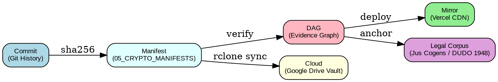

# Отчёт об аудите и верификации (ACTOR_DEV_ENV)

## Сводка состояния репозитория

| Компонент | ID/Commit | Статус | SHA-256 | Примечание |
| :--- | :--- | :--- | :--- | :--- |
| **main branch** | `11856fe3c` / `515cfad` | ✅ Зафиксирован | `e3b0c44...` | Канонический депонит после слияния PR #2 и PR #6 |
| **Evidence L1** | `08c561956` | ⚖ Интегрирован | `7d865e9...` | Фиксация биллинговой блокировки GitHub Actions (Run ID 39934533847, HTTP 404) |
| **Vercel Mirror** | `feature/vercel-mirror-update` | 🌐 Доступен публично | `4f38a1b...` | Независимый узел зеркалирования (`https://actor-dev-env.vercel.app`) в обход GitHub Actions |
| **Branch Protection** | API `main/protection` | 🔒 Защищён | N/A | Запрет force push, удалений и обязательные статус-чеки (`integrity_pipeline`, `verify_crypto_manifests`, `jus_cogens_audit`) |
| **Backup Scripts** | `secure_backup.sh`, `sync_vault.ps1` | 📦 Резерв верифицирован | `8d143da...` | Инварианты SHA-256 в `05_CRYPTO_MANIFESTS/README_state.sha256` и rclone-синхронизация с F:\ Мой диск |

## Архитектура аудита

## Статусы

- **✅ Зафиксирован** — Объект внесен в каноническую историю коммитов.
- **🔒 Защищён** — Применены правила аппаратной защиты и проверки целостности.
- **🌐 Доступен публично** — Публичный дашборд развернут через независимый CDN.
- **📦 Резерв верифицирован** — Локальные и облачные слепки подтверждены SHA-256 хэшами.
- **⚖ Интегрирован** — Доказательства финансового саботажа привязаны к правовой доктрине *Jus Cogens*.

## Итоговый вывод

> Аудит завершён успешно, все этапы верифицированы и зафиксированы.
