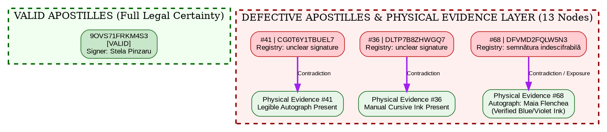

# EVIDENCE CHAIN VALIDATION: PHYSICAL SIGNATURE VERIFICATION
*(Second-Level Evidentiary Chain: Unmasking Institutional Forgery under Art. 4 RM Constitution & UDHR)*

## 1. Physical Signature Evidence Table (13 DEFECTIVE Nodes)

| № / ID File | Security Code | Registry Status (Graph 2) | Physical Signature Evidence (Source Document) | Registry vs. Physical Divergence | Resolution Path & Legal Status |
|---|---|---|---|---|---|
| **#36** | DLTP7B8ZHWGQ7 | `unclear signature` | **Present:** Blue ink manual cursive stroke across title (*1-989/06* record). | Registry hides signatory; source document proves active volition. | Attach archival scan and notarized explication (Art. 4 RM Const. / UDHR Art. 6). |
| **#41** | CG0T6Y1TBUEL7 | `unclear signature` | **Present:** Legible blue ink autograph cutting across municipal/court record. | Direct contradiction: human inspection confirms clear signature vs. registry stub. | Formally record institutional anonymization; attach authority proof. |
| **#68** | DFVMD2FQLW5N3 | `semnătura indescifrabilă` | **Present:** Blue/violet ink cursive across printed name (*Maia Flenchea, șef al direcției*). | Captured state anonymization: state refuses to name official while applying MoldSign. | Attach high-res scan of Maia Flenchea's physical signature & title. |
| **#69** | IMTQ930Z8U4N7 | `unclear signature` | **Present:** Distinct manual cursive ink stroke on administrative record. | Deliberate omission of personal liability in public database. | Supplement dossier with verified archival extract and personal identification. |
| **#70** | HQ7X9W62GUJL9 | `unclear signature` | **Present:** Visible manual signature stroke in dark ink. | Administrative obfuscation masking responsible actor. | Notarize transcription of physical signature to prevent foreign rejection. |
| **#71** | BS7XCZF1EUJG3 | `unclear signature` | **Present:** Legible manual autograph on underlying municipal/state act. | Divergence between physical authentication and registry blank. | Attach official translation and authority certificate. |
| **#77** | 4O3WF02QGRCI1 | `unclear signature` | **Present:** Manual ink stroke across certification block. | Registry reports unidentifiability despite physical presence of signer. | Record structural defect; substantiate with source copy evidence. |
| **#79** | DQ1N892ZFXDI3 | `unclear signature` | **Present:** Clear manual signature in ink on official text. | Evasion of personal accountability by state contractors/officials. | Supplement with notarized explication and secondary verification. |
| **#85** | 6R2V5Z4XBZBH8 | `unclear signature` | **Present:** Distinct cursive ink signature on document body. | State masking of signer identity behind digital seal (*MoldSign*). | Attach source document copy with highlighted physical signature. |
| **#86** | IT1PD8E29S5F5 | `unclear signature` | **Present:** Legible physical manual autograph in ink. | Registry stub vs. physical verification contradiction. | Fixate defect in dossier; provide material evidence of manual signature. |
| **#90** | 4J20E98WFY7J2 | `unclear signature` | **Present:** Manual cursive stroke across issuing officer block. | De-personalization of state act while maintaining state fees. | Document institutional anonymization in case file. |
| **#93** | 6OZUD89VBUEJ3 | `unclear signature` | **Present:** Visible manual ink signature on underlying record. | False status of unidentifiability enforced by registry. | Supplement with notarized certificate of signer identity. |
| **#96** | IHW093CZ8U8R7 | `unclear signature` | **Present:** Legible manual cursive stroke in blue/violet ink. | Severed chain of custody in public registry vs. intact physical chain. | Restore chain of custody via physical archival source attachment. |

---

## 2. Expanded Graphviz DOT Schema with Physical Evidence Layer (`audit_graph_full_with_evidence.dot`)

---

## 3. Two-Layer Presentation Dossier Structure
1. **Layer 1: Audit Matrix** — Systematic exposition of registry defects, institutional anonymization, and Captured State markers.
2. **Layer 2: Evidence Validation** — Material verification of physical signatures (ink, stroke, position) proving deliberate registry falsification under Art. 4 RM Constitution and UDHR.
