# MASTER AUDIT REPORT & PRESENTATION DOSSIER
*(Institutional Obfuscation & Captured State Anomalies in Apostille Registries)*

## 1. Graphviz DOT Schema with Integrated Legend (`audit_graph_full.dot`)

```dot
digraph ApostilleAuditMaster {
    rankdir=TB;
    newrank=true;
    compound=true;
    node [shape=box, style="filled,rounded", fontname="Arial", fontsize=10];
    edge [fontname="Arial", fontsize=8];

    # ==========================================
    # VALID NODES (Full Identification Chain)
    # ==========================================
    subgraph cluster_valid {
        label="VALID APOSTILLES\n(Fully Identified Signatories / Legal Certainty)";
        style="dashed,bold";
        color="darkgreen";
        bgcolor="#f0fff0";

        VALID_9OVS71FRKM4S3 [label="9OVS71FRKM4S3\n[VALID]\nSigner: Stela Pinzaru\nOfficer: Valeriu Frimu", fillcolor="#c8e6c9", color="#2e7d32"];
        VALID_9T3M953ZBUHO4 [label="9T3M953ZBUHO4\n[VALID]\nSigner: Guzun Corneliu\nCase: 29244", fillcolor="#c8e6c9", color="#2e7d32"];
    }

    # ==========================================
    # DEFECTIVE NODES (Captured State / Anonymized)
    # ==========================================
    subgraph cluster_defective {
        label="DEFECTIVE APOSTILLES (13 Archive Nodes)\n(Anonymized Signature / Captured State Anomalies / Jus Cogens Defect)";
        style="dashed,bold";
        color="darkred";
        bgcolor="#fff0f0";

        # Primary Exemplars
        DEF_68_DFVMD2FQLW5N3 [label="#68 | DFVMD2FQLW5N3\n[DEFECTIVE]\nRegistry: semnătura indescifrabilă\nSource Doc: Maia Flenchea (Physical)", fillcolor="#ffcdd2", color="#c62828"];
        DEF_36_DLTP7B8ZHWGQ7 [label="#36 | DLTP7B8ZHWGQ7\n[DEFECTIVE]\nRegistry: unclear signature\nCase: 1-989/06", fillcolor="#ffcdd2", color="#c62828"];
        DEF_41_CG0T6Y1TBUEL7 [label="#41 | CG0T6Y1TBUEL7\n[DEFECTIVE]\nRegistry: unclear signature\nSec: 2013074491511", fillcolor="#ffcdd2", color="#c62828"];

        # Additional 10 Archive Defective Nodes
        DEF_69_IMTQ930Z8U4N7 [label="#69 | IMTQ930Z8U4N7\n[DEFECTIVE]\nRegistry: unclear signature\nSHA256: 87797efa...", fillcolor="#ffe0b2", color="#e65100"];
        DEF_70_HQ7X9W62GUJL9 [label="#70 | HQ7X9W62GUJL9\n[DEFECTIVE]\nRegistry: unclear signature\nSHA256: c0abbc94...", fillcolor="#ffe0b2", color="#e65100"];
        DEF_71_BS7XCZF1EUJG3 [label="#71 | BS7XCZF1EUJG3\n[DEFECTIVE]\nRegistry: unclear signature\nSHA256: d282b3de...", fillcolor="#ffe0b2", color="#e65100"];
        DEF_77_4O3WF02QGRCI1 [label="#77 | 4O3WF02QGRCI1\n[DEFECTIVE]\nRegistry: unclear signature\nSHA256: 0c40abe4...", fillcolor="#ffe0b2", color="#e65100"];
        DEF_79_DQ1N892ZFXDI3 [label="#79 | DQ1N892ZFXDI3\n[DEFECTIVE]\nRegistry: unclear signature\nSHA256: 39f2685f...", fillcolor="#ffe0b2", color="#e65100"];
        DEF_85_6R2V5Z4XBZBH8 [label="#85 | 6R2V5Z4XBZBH8\n[DEFECTIVE]\nRegistry: unclear signature\nSHA256: 92353e92...", fillcolor="#ffe0b2", color="#e65100"];
        DEF_86_IT1PD8E29S5F5 [label="#86 | IT1PD8E29S5F5\n[DEFECTIVE]\nRegistry: unclear signature\nSHA256: 5aa37f3f...", fillcolor="#ffe0b2", color="#e65100"];
        DEF_90_4J20E98WFY7J2 [label="#90 | 4J20E98WFY7J2\n[DEFECTIVE]\nRegistry: unclear signature\nSHA256: a3545538...", fillcolor="#ffe0b2", color="#e65100"];
        DEF_93_6OZUD89VBUEJ3 [label="#93 | 6OZUD89VBUEJ3\n[DEFECTIVE]\nRegistry: unclear signature\nSHA256: d85a9d4c...", fillcolor="#ffe0b2", color="#e65100"];
        DEF_96_IHW093CZ8U8R7 [label="#96 | IHW093CZ8U8R7\n[DEFECTIVE]\nRegistry: unclear signature\nSHA256: 6ce1d06a...", fillcolor="#ffe0b2", color="#e65100"];
    }

    # ==========================================
    # VISUAL LEGEND SUBGRAPH
    # ==========================================
    subgraph cluster_legend {
        label="EXPLANATORY LEGEND / AUDIT ARCHITECTURE";
        style="solid,bold";
        color="black";
        bgcolor="#fcfcfc";

        node [shape=plaintext, fontsize=9, fontname="Arial"];

        LEGEND_BOX [label=<
            <TABLE BORDER="0" CELLBORDER="1" CELLSPACING="0" CELLPADDING="4">
              <TR><TD BGCOLOR="#c8e6c9"><B>VALID Node</B></TD><TD>Full identification chain; signer and officer verified (Hague Art. 3 compliant).</TD></TR>
              <TR><TD BGCOLOR="#ffcdd2"><B>DEFECTIVE Primary</B></TD><TD>Core exemplar with physical signature present but anonymized in registry.</TD></TR>
              <TR><TD BGCOLOR="#ffe0b2"><B>DEFECTIVE Archive</B></TD><TD>10 additional archive nodes with SHA-256 anchors and 'unclear signature' defect.</TD></TR>
              <TR><TD><FONT COLOR="blue"><B>Solid Blue Edge</B></FONT></TD><TD>Audit contrast: direct comparison between valid identification and state masking.</TD></TR>
              <TR><TD><FONT COLOR="red"><B>Dotted Red Edge</B></FONT></TD><TD>Systemic pattern linking captured state anomalies across the archive.</TD></TR>
            </TABLE>
        >];
    }

    # ==========================================
    # AUDIT RELATIONSHIPS & CONTRADICTIONS
    # ==========================================
    VALID_9OVS71FRKM4S3 -> DEF_68_DFVMD2FQLW5N3 [label="Audit Contrast: Full Name vs. Anonymized", color="blue", style="bold"];
    VALID_9T3M953ZBUHO4 -> DEF_36_DLTP7B8ZHWGQ7 [label="Audit Contrast: Verified Signer vs. Masked", color="blue", style="bold"];

    # Shared Structural Defect Cluster Connections
    DEF_68_DFVMD2FQLW5N3 -> DEF_69_IMTQ930Z8U4N7 [style="dotted", color="red", label="Systemic Pattern"];
    DEF_68_DFVMD2FQLW5N3 -> DEF_70_HQ7X9W62GUJL9 [style="dotted", color="red"];
    DEF_68_DFVMD2FQLW5N3 -> DEF_71_BS7XCZF1EUJG3 [style="dotted", color="red"];
    DEF_36_DLTP7B8ZHWGQ7 -> DEF_77_4O3WF02QGRCI1 [style="dotted", color="red"];
    DEF_36_DLTP7B8ZHWGQ7 -> DEF_79_DQ1N892ZFXDI3 [style="dotted", color="red"];
    DEF_41_CG0T6Y1TBUEL7 -> DEF_85_6R2V5Z4XBZBH8 [style="dotted", color="red"];
    DEF_41_CG0T6Y1TBUEL7 -> DEF_86_IT1PD8E29S5F5 [style="dotted", color="red"];
    DEF_41_CG0T6Y1TBUEL7 -> DEF_90_4J20E98WFY7J2 [style="dotted", color="red"];
    DEF_41_CG0T6Y1TBUEL7 -> DEF_93_6OZUD89VBUEJ3 [style="dotted", color="red"];
    DEF_41_CG0T6Y1TBUEL7 -> DEF_96_IHW093CZ8U8R7 [style="dotted", color="red"];
}
```

## 2. Executive Summary & Auditor Brief

1. **Essence of Institutional Defect:** Hague Convention 1961 (Art. 3, 5) requires apostilles to authenticate specific signatures. While physical source documents display legible manual signatures (e.g., *Maia Flenchea* on node #68), the state registry fraudulently populates Field #2 with `semnătura indescifrabilă` / `unclear signature` while layering digital stamps (*MoldSign*).
2. **Visual Architecture:** Green cluster = VALID benchmark nodes; Red/Orange cluster = 13 DEFECTIVE archive nodes secured with SHA-256 hashes; Solid blue edges = audit contrasts; Dotted red edges = systemic anonymization pattern.
3. **Sovereign Resolution Path:** Fixate that the apostille confirms signature existence rather than signer identity, and supplement the dossier with primary archival scans/certifications.
