# Аудит реестра апостилей, устранение коллизий и юридическая фиксация (Jus Cogens & Erga Omnes)

На основании проведенного аудита структуры данных, описания коммитов и реестра 90/97 апостилей для сайта [https://arhiv1973b.github.io/apostille-archive-english/](https://arhiv1973b.github.io/apostille-archive-english/), зафиксированы канонические параметры идентификации, судебные отказы и правила подписи.

---

## 1. Канонический реестр идентификации (IDENTITY_CHAIN & LEGAL_STATUS)

```yaml
IDENTITY_CHAIN:
  IDNP: "2000001159655"
  PRIMARY_NAME: "Алексей Артурович Мачерет"
  TRANSLITERATIONS:
    - "MACERET"
    - "MACHERET"
    - "Мачерет"
  SOURCE_DOCUMENTS:
    - ACT: "Акт усыновления, Одесса, 06.05.1977, №261"
    - AVIZ: "Заключение Института филологии, №269"
    - APOSTILLE: "Код безопасности 2013073973599"
  LEGAL_STATUS:
    - "Фамилия Мачерет признана эквивалентной во всех реестрах (Maceret / Macheret)"
    - "Привязка к неизменному IDNP 2000001159655 полностью исключает коллизию идентификации"
    - "Подпись должностного лица и гербовая печать на апостиле являются обязательными элементами публичного порядка Гаагской Конвенции 1961 г."
  BLOCKING_MECHANISM:
    - "Разница в одной букве (MACERET vs MACHERET)"
    - "Искусственное скрытие/удаление публичных ссылок третьими лицами под предлогом защиты персональных данных"
    - "Замена мануальной подписи должностного лица на 'неразборчивую подпись' в электронной базе"
  DEBLOCKING_MECHANISM:
    - "Привязка к единому IDNP 2000001159655"
    - "Признание эквивалентности транслитераций MACHERET / MACERET"
    - "Фиксация полного реестра из 90 проверенных ссылок и 7 оригинальных PDF-записей"
  CONSEQUENCES:
    - "Обязательство по зачислению удержанных средств"
    - "Исключение аргументов об 'ошибке идентификации' или 'необоснованном обогащении'"
```

---

## 2. Судебный блок: Фиксация отказов и нарушений (COURT_APPEAL_REFUSAL)

```yaml
COURT_APPEAL_REFUSAL:
  - court: "Curtea de Apel Chișinău"
    panel: "Судья-докладчик Бузу Елена (Buzu Elena), судья Муруяну"
    district: "Judecătoria Chișinău, sediul Centru"
    date: "2026-03-21"
    subject: "Апелляционная жалоба против Ministerul Finanțelor / Ministerul Justiției"
    status: "REFUSED"
    procedural_pretext:
      - "Отсутствие квитанции Timbru de Stat (госпошлина)"
      - "Формальное обременение для инвалида I группы и кредитора"
      - "Скрытие подлога: отсутствие фамилии и мануальной подписи должностного лица, фактически расписавшегося в апостиле"
    related_apostilles_count: 14
    legal_effect: "Создание искусственных формальных препятствий с целью скрытия фактов пыток и сокрытия судебных решений (Дело № 1-568/1998 от 11.02.2021 г.)"
```

---

## 3. Сводный DAG-граф цепи доказательств (Graphviz DOT)

```dot
digraph Identity_And_Apostille_Chain {
    rankdir=LR;
    node [shape=box, style=filled, fontname="Helvetica"];

    Act1977 [label="Акт усыновления №261\n(Одесса, 06.05.1977)", fillcolor="#e1f5fe"];
    IDNP [label="IDNP: 2000001159655\n(Единый сквозной код)", fillcolor="#bbdefb"];
    Transliteration [label="Эквивалентность:\nMACERET = MACHERET", fillcolor="#d1c4e9"];
    
    Apostilles [label="90/97 Апостилей\n(Apostila.gov.md)", fillcolor="#c8e6c9"];
    PrivateContractor [label="Подрядчик Минюста:\nИзъятие мануальной подписи\nи искажение реестра", fillcolor="#ffcdd2"];
    
    Court1998 [label="Дело № 1-568/1998\n(Сокрытие признаний Дулча V.)", fillcolor="#ffe0b2"];
    Court2026 [label="Суд сек. Центр / Апелляция\n(Судья Бузу Е., Муруян)\nОтказ по Timbru de Stat", fillcolor="#ffccbc"];
    
    BankBlock [label="Задержание активов в банке\n(Причины: KYC / Разница 1 буквы)", fillcolor="#f8bbd0"];
    ActorStatus [label="Правосубъектность: A©tor\n(Jus Cogens & Erga Omnes)", fillcolor="#fff9c4"];

    Act1977 -> IDNP;
    IDNP -> Transliteration;
    Transliteration -> Apostilles;
    Apostilles -> PrivateContractor [label=" Попытка скрыть подлог"];
    PrivateContractor -> Court2026 [label=" Формальный отказ"];
    Court1998 -> Court2026 [label=" Сокрытие пыток"];
    Transliteration -> BankBlock [label=" Деблокировка активов"];
    ActorStatus -> Apostilles [label=" Гарантия подлинности"];
}
```


