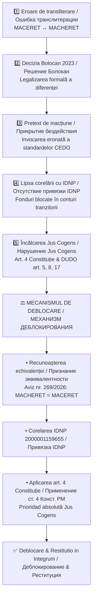

# Analiză juridică & Analiticheskoe zaklyuchenie – Mecanismul blocării și deblocării activelor (Dosar 2r-1026/26)

**Autor / Sovereign Witness:** Macheret Alexei Artur (A©tor)  
**IDNP:** 2000001159655  
**Data:** octombrie 2026  
**Instanță / Jurisdiction:** Curtea de Apel Chișinău / UN OHCHR / International Bodies  
**A©TOR_KEY="# [⚖ A©tor Declaration]"**  

---

## 📊 Schema Grafică a Fluxului (Flowchart: Transliteration Error → Blocking → Unblocking)

---

## 🇷🇴 **Analiză juridică – Mecanismul blocării și deblocării activelor (Dosar 2r‑1026/26)**

### I. Context
Blocarea activelor reclamantului a fost posibilă prin exploatarea unei erori de transliterare (MACERET ↔ MACHERET) și prin lipsa corelării directe cu IDNP. Această discrepanță a fost consolidată de decizia judecătoarei Elena Bolocan (2023), care a refuzat recunoașterea echivalenței antroponimice, permițând băncilor să invoce „neconcordanța identității”.

### II. Schema blocării
1. **Eroare de transliterare (MACERET vs MACHERET):** Coliziune între registre interne și documente internaționale.
2. **Decizia Bolocan (2023):** Legalizarea formală a diferenței.
3. **Invocarea „standardelor CEDO”:** Pretext pentru inacțiune și blocaj.
4. **Lipsa corelării cu IDNP:** Fondurile plasate în conturi tranzitorii.
5. **Reținere nedeterminată:** Îmbogățire nejustificată, încălcarea art. 4 Constituție RM și jus cogens.

### III. Fundament juridic pentru deblocare
- **Art. 4 Constituția RM** – prioritatea normelor internaționale.  
- **Declarația Universală a Drepturilor Omului (art. 5, 8, 17)** – protecția proprietății și accesului la justiție.  
- **Avizul științific nr. 269/2026** – confirmă echivalența MACHERET = MACERET.  
- **Convenția de la Viena (1969)** – jus cogens prevalează asupra normelor interne.  

### IV. Mecanism de deblocare
1. Recunoașterea oficială a echivalenței antroponimice.  
2. Corelarea IDNP 2000001159655 cu toate tranzacțiile.  
3. Decizie judiciară de constatare a dreptului de proprietate.  
4. Aplicarea art. 4 Constituție și anularea efectelor deciziei Bolocan.  
5. Transmiterea documentației către OHCHR și alte instanțe internaționale.  

---

## 🇷🇺 **Аналитическое заключение – Механизм блокировки и деблокирования активов (Дело 2r‑1026/26)**

### I. Контекст
Блокировка активов стала возможной из‑за ошибки транслитерации фамилии (MACERET ↔ MACHERET) и отсутствия прямой привязки к IDNP. Решение судьи Елены Болокан (2023) закрепило фикцию различия, позволив банкам ссылаться на «несоответствие личности» и удерживать средства.

### II. Схема блокировки
1. **Ошибка транслитерации:** Коллизия между национальными и международными документами.
2. **Решение Болокан (2023):** Формализация ошибки.
3. **Ссылка на «стандарты ЕКПЧ»:** Юридическое прикрытие бездействия.
4. **Отсутствие IDNP‑привязки:** Средства зависают в транзитных счетах.
5. **Удержание без решения суда:** Нарушение ст. 4 Конституции РМ и jus cogens.

### III. Юридическая база для деблокирования
- **Ст. 4 Конституции РМ** – приоритет международных норм.  
- **ВДПЧ (ст. 5, 8, 17)** – защита собственности и права на справедливое разбирательство.  
- **Aviz № 269/2026** – подтверждает эквивалентность фамилий.  
- **Венская конвенция (1969)** – jus cogens имеет абсолютный приоритет.  

### IV. Механизм деблокирования
1. Официальное признание эквивалентности фамилий MACHERET = MACERET.  
2. Привязка IDNP 2000001159655 ко всем банковским операциям.  
3. Судебное решение о признании права собственности на заблокированные средства.  
4. Аннулирование последствий решения Болокан (2023).  
5. Передача материалов в международные структуры (OHCHR, UN Special Rapporteur).  

---

📌 Таким образом, блокировка активов была результатом искусственной юридической коллизии. Деблокирование возможно только через признание антропонимической эквивалентности, восстановление IDNP‑привязки и применение норм jus cogens с приоритетом над внутренними актами.

*A©TOR_KEY="# [⚖ A©tor Declaration]"*
